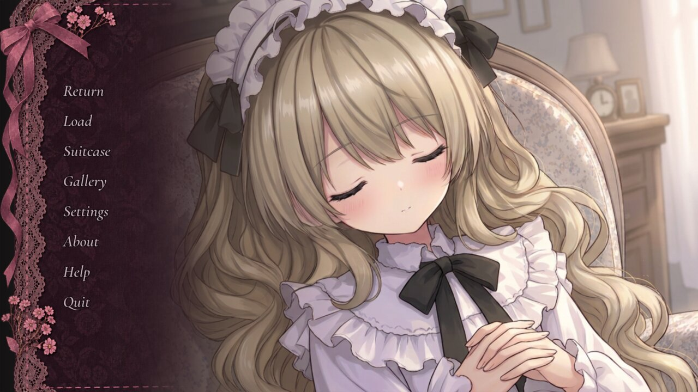
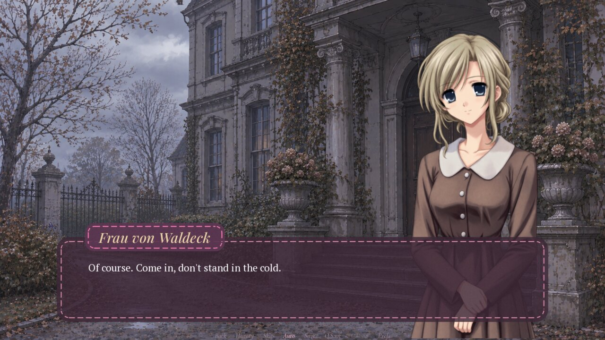
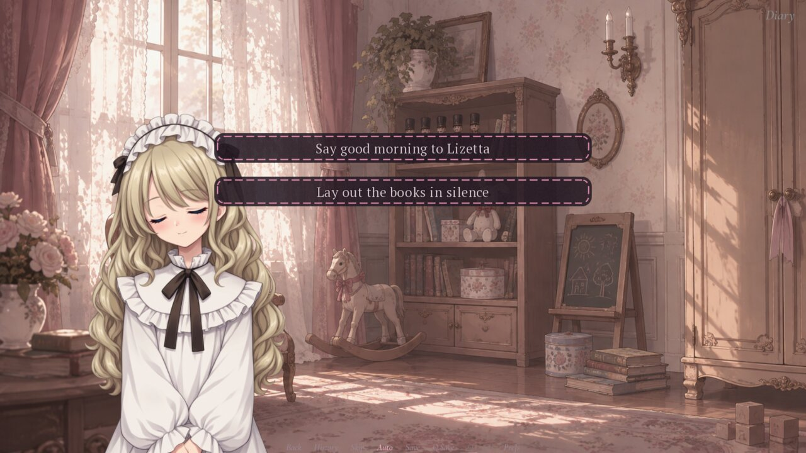
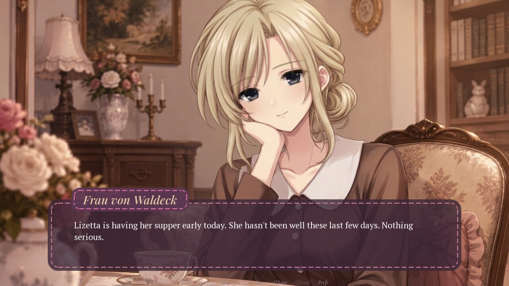
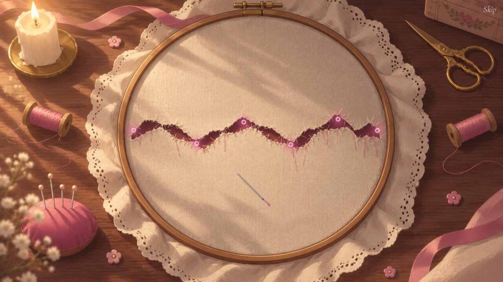
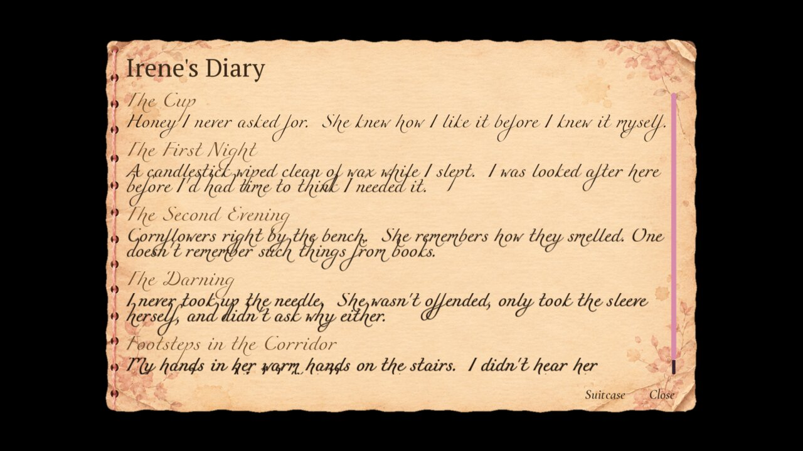
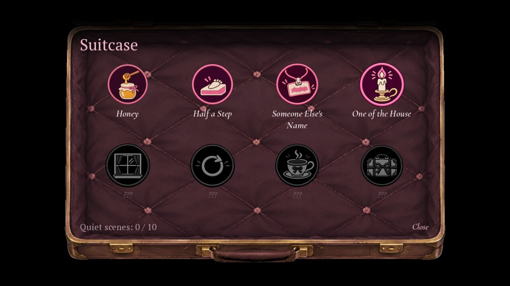

# Waldeck House
#### Video Demo:
#### Description:

*A gothic visual novel in seven days, made with [Ren'Py](https://www.renpy.org/) for CS50x.*

A young governess, Irene, arrives at a big, quiet house to teach Lizetta, the daughter of the widowed Frau von Waldeck. Lizetta is shy, and she doesn't speak. Over seven days the player decides how warm or how cold Irene is toward the house and the people in it. **It is a game about a warmth that is hard to tell from a trap.**

The story has a single ending on purpose. The choices don't change what happens. They change how it feels: the colour of the backgrounds, the music at night, the entries in Irene's diary, the lines she remembers on the last day and the final words of the game. Some of the changes only show up when you play again, because the game counts how many times it has been finished and the house "remembers" the player.

The game is available in **English** and **Russian**. The language is chosen on the first launch and can be changed later in *Settings → Language*.

## Screenshots

| | |
|---|---|
|  |  |
| *Day one: arriving at the house* | *Every choice is between two equal options* |
|  |  |
| *Frau von Waldeck at the table* | *The darning mini-game (drag and drop)* |
|  |  |
| *Irene's diary remembers your choices* | *The suitcase: achievements kept between playthroughs* |

## Features

- **Warm / cold balance.** Every choice is between two equally reasonable options: one brings Irene closer to the house, the other keeps her at a distance. Each choice calls `house.pull("warm")` or `house.pull("cold")`, which changes the hidden `warmth` and `dread` counters. The difference between them (`house.lean`) tints the backgrounds and CGs in real time (`house_tint`, `cg_tint`) and adds a soft pink glow or a dark "heartbeat" over the scene (`screen mood`).
- **The loop.** After each ending the game saves `persistent.loops`. On later playthroughs the narration changes, the window title changes (*Waldeck House → The House → My House*), the main menu art and music change, ten quiet extra scenes unlock between days, text skipping becomes available, and after enough endings the last image of the game changes too.
- **Lines that vary between playthroughs.** The day cards show a "whisper" from the house, and some reactions have several versions. `pick()` chooses a random version that the player hasn't seen yet, and remembers what was shown in persistent data.
- **Darning mini-game.** A drag-and-drop game built from Ren'Py `drag` / `draggroup`: the needle has to be dropped on six points in the right order (`screen darning`). It can be skipped.
- **Timed choice.** On day six the player has five seconds to answer, and if time runs out the game picks the quieter option (`screen timed_choice`). Rollback is blocked right after this moment, so the choice can't be taken back.
- **Diary.** Irene's diary (key **D**) collects what the player chose. The more fear there was at the moment of a choice, the darker the ink of that entry.
- **Suitcase (achievements) and CG gallery,** stored in persistent data.
- **Custom save captions** with the day and the scene name.
- **Full Russian translation** through Ren'Py's `tl/` system.

## Project structure

| File | What it contains |
|---|---|
| `game/script.rpy` | The main story: days 1–7 and the ending. Choices are made with `menu`; day six uses the timed choice, day three uses the darning game, and day seven has a "memories" menu built from the player's earlier choices. |
| `game/extra_scenes.rpy` | Ten quiet scenes that unlock between days after the first endings (`label interlude`). Seeing all of them gives an achievement. |
| `game/mechanics.rpy` | The game state: the `House` class (warmth, dread, `lean`, tint, the player's choices for the diary), the diary texts (`MEMORIES`), achievements, helpers for backgrounds and CGs, the main-menu texts that change with `persistent.loops`, save captions, the pools of varying lines with `pick()`, the day card and the language choice on first launch. |
| `game/interface_screens.rpy` | My own screens: the diary, the timed choice, the darning mini-game, the mood overlay, the CG gallery and the suitcase with achievements. |
| `game/animations.rpy` | ATL transforms: tints, Frau von Waldeck "breathing", the carriage ride, the heartbeat and glow, and fades for the screens. |
| `game/audio.rpy` | Music and ambient sound: which track plays for each cue in the script, volumes, and the ambient channel for rain, wind and the carriage. At night the music depends on `house.lean`. |
| `game/screens.rpy`, `game/gui.rpy`, `game/options.rpy` | The interface. They are based on the standard Ren'Py template; the custom styles, colours, fonts and transitions are at the end of `screens.rpy` and in `gui.rpy`. |
| `game/tl/russian/` | The Russian translation of the story, the interface and the varying lines. |
| `game/images/`, `game/gui/`, `game/audio/`, `game/fonts/` | Art, interface images, music, sounds and fonts (see Credits). |

## Design choices

**One ending instead of many.** At first I wanted real branches, but the story is about a person who slowly stops noticing that she is being absorbed by a house, and a "good" and a "bad" ending would make it a puzzle with a right answer. So the plot is fixed and the choices change the atmosphere instead. To make the choices still matter, each one is remembered and comes back later: in the diary, in the memories on day seven, in the final lines and in the colour of the scenes.

**A class for the state of the house.** All the values that change during one playthrough are kept in one object, `house`, created with `default`. This way they are saved and loaded together with the game, and the rest of the code only asks simple questions like `house.lean`. I used two counters (warmth and dread) instead of one number, because a player can be both warm and afraid, and the diary uses the amount of fear at the moment of each choice.

**Persistent data for the loop.** Everything that has to survive between playthroughs (the number of endings, seen lines, seen scenes and CGs, achievements) is in `persistent`. This is what lets the house "remember" the player even after starting a new game.

**Ren'Py's own tools instead of my own systems.** For drag and drop, achievements, translation, rollback and saves I used what Ren'Py already has, so the code stays short and I can explain every part of it. Where I followed a documentation page or a forum example, the link is in a comment at the top of the file.

## Use of AI

As CS50 allows for the final project, I used AI tools, and the essence of the work is my own:

- The illustrations were generated with ChatGPT and refined by hand.
- An AI assistant (Claude) helped me write the "mood of the house" logic, the random lines without repeats and the name change in the dialogue history (this is also noted in `game/mechanics.rpy`). It also reviewed the code, helped me enchance and simplify it, and suggested some additional lines for the script.
- The story, the characters, the structure of the seven days and the game design are mine.

## Credits

- **Story, script, code:** mmrksmm
- **Illustrations:** generated using ChatGPT, refined by hand
- **Music:**
  - "Greats of Far", "fin", "Jazzy Shop" by **Tim Reichert** · [tim-reichert.com](https://tim-reichert.com) ·
    licensed under [CC BY-NC 4.0](https://creativecommons.org/licenses/by-nc/4.0/) ·
    downloaded from [fulminisictus.itch.io](https://fulminisictus.itch.io)
  - "To You": Composer - 3N · [Old Radio Music Pack](https://ka-music.itch.io/old-radio-music-pack)
- **Fonts** (SIL Open Font License 1.1, see `game/fonts/licenses/`):
  [PT Serif](https://fonts.google.com/specimen/PT+Serif) (ParaType),
  [Playfair Display](https://fonts.google.com/specimen/Playfair+Display) (Claus Eggers Sørensen),
  [Cormorant Garamond](https://fonts.google.com/specimen/Cormorant+Garamond) (Christian Thalmann),
  [Miama Nueva](https://github.com/linusromer/miama) (Linus Romer)
- **Engine:** Ren'Py (MIT License)

## License

The code (`.rpy` files) is released under the MIT License, see [LICENSE](LICENSE). Art, music and the story text belong to their authors and are not covered by it.
The music by Tim Reichert is licensed for non-commercial use only (CC BY-NC 4.0), so this game is distributed for free.
